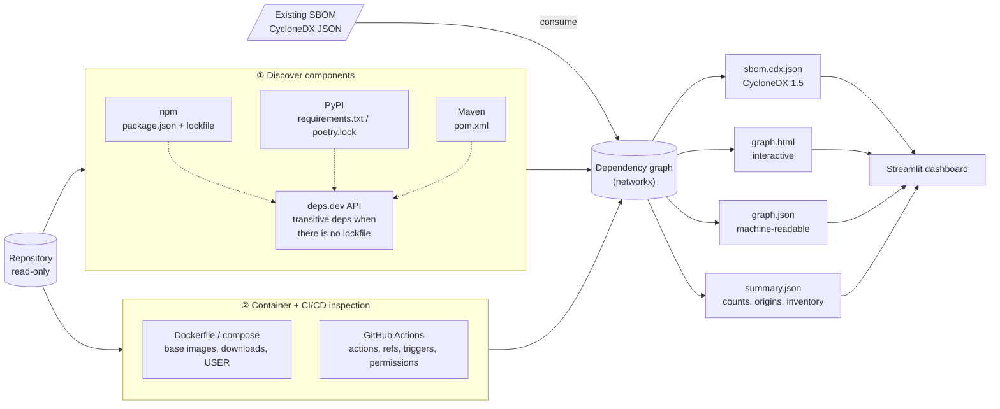

# 🛡️ Software Supply Chain Guardian (SSCG)

> **Know what you build. Trust what you ship.**
> Bosch × Amrita hackathon · Problem statement: *Software Supply Chain Guardian*
> Status: **Day 1, columns 1–2 complete**: *Discover Components* and *Build the Supply Chain View*

SSCG scans a repository **without installing or running anything**. It inventories every component the application depends on: libraries, transitive dependencies, container base images, CI/CD actions and files downloaded at build time. It records where each one comes from, generates a standard **CycloneDX SBOM**, and draws an interactive **dependency graph**.

---

## Table of contents

1. [What problem this solves](#1-what-problem-this-solves)
2. [Scope: what is done and what is next](#2-scope-what-is-done-and-what-is-next)
3. [Quick start](#3-quick-start)
4. [How it works](#4-how-it-works)
5. [Command-line reference](#5-command-line-reference)
6. [Outputs](#6-outputs)
7. [The SBOM in detail](#7-the-sbom-in-detail)
8. [Container image and CI/CD inspection](#8-container-image-and-cicd-inspection)
9. [The dashboard](#9-the-dashboard)
10. [Results on the sample applications](#10-results-on-the-sample-applications)
11. [How the results were verified](#11-how-the-results-were-verified)
12. [Repository layout](#12-repository-layout)
13. [Tech stack](#13-tech-stack)
14. [Safety and responsible use](#14-safety-and-responsible-use)
15. [Known limitations](#15-known-limitations)
16. [Roadmap](#16-roadmap)
17. [Troubleshooting](#17-troubleshooting)

---

## 1. What problem this solves

Modern applications are assembled from open-source libraries, transitive dependencies, container images, build tools and CI/CD components, and all of these change continuously. Before a team can judge which risks matter, it has to answer a more basic question: **what is actually in the application, and where did each piece come from?**

For example, in `nodejs-goof` (one of our sample apps) the developers chose **35** packages, yet the application ships **980**. That means 96% of the code was pulled in by something else, up to **10 levels deep**. The app also depends on 3 container images and 6 third-party GitHub Actions, none of which appear in `package.json`.

SSCG makes all of this visible.

---

## 2. Scope: what is done and what is next

The problem statement splits Day 1 ("Build the Guardian's Eyes") into five columns. This repository completes **columns 1 and 2**:

| Day 1 column | Requirement from the slide | Status | Where in the code |
|---|---|---|---|
| **1 · Discover Components** | Analyze package manifests and lockfiles | ✅ | `sscg/discover/npm.py`, `pypi.py`, `maven.py` |
| | Identify direct and transitive dependencies | ✅ | lockfiles; [deps.dev](https://deps.dev) when no lockfile exists (`discover/depsdev.py`) |
| | Capture component names and versions | ✅ | every node in `graph.json`, every component in `sbom.cdx.json` |
| **2 · Build the Supply Chain View** | Generate **or** consume an SBOM (CycloneDX or SPDX) | ✅ **both** | `sscg/sbom.py`, CycloneDX 1.5 JSON |
| | Build the dependency graph | ✅ | `sscg/graph.py`, `sscg/export.py` |
| | Identify where each component originates | ✅ | registry / download URL per component |
| | Inspect at least one container image **or** CI/CD workflow | ✅ **both** | `discover/docker.py`, `discover/gha.py` |
| 3 · Detect Vulnerabilities | CVE, severity, fixes; trace transitive vulns to source | ⏳ next | (an OSV overlay already marks packages with published advisories) |
| 4 · Detect Suspicious Changes | typosquats, install scripts, untrusted images, lockfile changes … | ⏳ | |
| 5 · Present Evidence | component, path, evidence, initial risk level | ⏳ | |

---

## 3. Quick start

**Requirements:** Python **3.11+**. Developed and tested on Windows 11 with Python 3.12.4. The code uses only portable Python, but macOS and Linux have not been tested. Node, npm, Maven and Docker are **not** needed to scan.

```powershell
# 1. get the code
git clone https://github.com/gshyamv/Bosch-Hackathon.git
cd Bosch-Hackathon\sscg

# 2. install dependencies (a virtual environment is optional but recommended)
python -m venv .venv
.\.venv\Scripts\Activate.ps1          # macOS/Linux: source .venv/bin/activate
pip install -r requirements.txt

# 3. scan a sample application
python -m sscg scan ..\targets\sscg-demo-target

# 4. open the results
start out\sscg-demo-target\graph.html # interactive graph (macOS: open, Linux: xdg-open)
streamlit run ui/app.py               # full dashboard at http://localhost:8501
```

The repository ships with cached API responses (`sscg/.cache/`), so you can add `--offline` to any scan and it works without internet.

**Getting the sample applications.** `targets/sscg-demo-target` is our own test fixture. `nodejs-goof` is a public, deliberately vulnerable app from Snyk. If `targets/nodejs-goof` is missing:
```powershell
git clone --depth 1 https://github.com/snyk-labs/nodejs-goof.git targets\nodejs-goof   # scanned at commit add14ba
```
> Both sample apps are git repositories of their own. `sscg-demo-target` needs its 2-commit history for the later "what changed" pillar. Commit them as submodules or as plain files; otherwise a fresh clone of this repo will have empty `targets/` folders.

---

## 4. How it works



### 4.1 The graph model

Everything is one directed graph:

```
repo  ──►  manifest / Dockerfile / workflow  ──►  component  ──►  component  ──► …
 ★              (the "apps")                       (direct)        (transitive)
```

* **Repo node:** the repository itself.
* **App nodes:** one per `package.json`, `requirements.txt`, `pom.xml`, `Dockerfile`, compose file or workflow.
* **Component nodes:** libraries, container images, GitHub Actions and downloaded files. Each node is identified by its [package URL (purl)](https://github.com/package-url/purl-spec), e.g. `pkg:npm/qs@2.4.2`, so a package used by many parents appears **once**, with many incoming edges.
* **Edges:** "depends on". Each edge keeps the version range it was requested with and, for container and CI uses, the exact `file:line`.
* **Depth:** 1 = direct dependency, 2 = dependency of a direct dependency, and so on.

### 4.2 How each ecosystem is resolved

| Ecosystem | Input files | How transitive dependencies are found | Accuracy |
|---|---|---|---|
| npm | `package-lock.json` v1/v2/v3, `npm-shrinkwrap.json`, `yarn.lock` v1 | read from the lockfile, using Node's own `node_modules` lookup rules | exact |
| npm (no lockfile) | `package.json` | deps.dev resolves the lowest version in each range | approximate (`deps.dev-approx`) |
| PyPI | `poetry.lock` | read from the lockfile | exact |
| PyPI | `requirements*.txt` (incl. `-r` includes) | deps.dev resolves each pinned package | exact for `==` pins, approximate otherwise |
| Maven | `pom.xml` (`${properties}`, `dependencyManagement`, parent version) | deps.dev | exact for explicit versions; versions inherited from an external parent POM show as `managed-by-parent` |
| Container | `Dockerfile`, `Containerfile`, `docker-compose*.yml` | static parsing | exact (what the file says) |
| CI/CD | `.github/workflows/*.yml` | static parsing | exact (what the file says) |

Every component records how it was resolved (`resolution`: `lockfile`, `deps.dev`, `deps.dev-approx`, `dockerfile`, `compose`, `workflow`, `sbom`, `unresolved`), so it is always clear which facts are exact.

---

## 5. Command-line reference

```
python -m sscg scan <repo> [--out DIR] [--sbom FILE] [--osv] [--offline]
                           [--why NAME ...] [--focus NAME] [--max-depth N]
```

Run it from inside the `sscg/` folder.

| Option | Meaning |
|---|---|
| `<repo>` | Folder to scan. It is only read: nothing is installed, built or executed. |
| `--out DIR` | Output folder. Default: `out/<repo name>/`. |
| `--sbom FILE` | **Consume** a CycloneDX JSON SBOM (from SSCG, Syft, cdxgen …) instead of scanning manifests. |
| `--osv` | Mark packages that have published security advisories (OSV.dev). Graph colouring only. |
| `--offline` | Answer every API call from `.cache/`. No network. |
| `--why NAME …` | Print every dependency path that pulls `NAME` into the app. |
| `--focus NAME` | `graph.html` shows only that package, everything that depends on it, and everything it depends on. |
| `--max-depth N` | `graph.html` shows only N levels. Graphs over 600 nodes are cut to 2 levels automatically (packages with advisories and their paths are always kept). |

### Examples

```powershell
# full scan with vulnerability colouring and two "why" questions
python -m sscg scan ..\targets\nodejs-goof --osv --why qs lodash

# the three paths that bring qs into nodejs-goof, as a small graph
python -m sscg scan ..\targets\nodejs-goof --osv --focus qs --out out\nodejs-goof-focus-qs

# consume an SBOM produced elsewhere
python -m sscg scan ..\targets\nodejs-goof --sbom path\to\bom.cdx.json --out out\goof-from-sbom

# no internet
python -m sscg scan ..\targets\sscg-demo-target --osv --offline
```

<details>
<summary><b>Sample terminal output</b> (sscg-demo-target)</summary>

```
=== Supply chain view: sscg-demo-target ===
              apps: ['ci  (.github/workflows/ci.yml)', 'Dockerfile  (Dockerfile)', 'com.acme:notifier@1.0.0  (notifier/pom.xml)', 'acme-orders@1.0.0  (package.json)', 'worker  (worker/requirements.txt)']
  components_total: 31
          packages: 25
      by_ecosystem: {'github-actions': 3, 'url': 2, 'docker': 1, 'maven': 8, 'npm': 7, 'pypi': 10}
            direct: 13
        transitive: 12
         max_depth: 2
           origins: {'github.com': 3, 'get.example.invalid': 2, 'docker.io': 1, 'registry.npmjs.org': 6, 'npm-mirror.example.invalid': 1}
 untrusted_origins: ['lodash@4.17.15 <- https://npm-mirror.example.invalid/lodash/-/lodash-4.17.15.tgz']
   install_scripts: ['crossenv@7.0.3']
  CONTAINER Dockerfile: images ['fastbuilds42/node:latest'], runs as: not set (inherits the base image default), downloads ['http://get.example.invalid/bootstrap.sh']
    image fastbuilds42/node:latest: registry docker.io, official False, pinned by digest False, used in ['Dockerfile:1']
  CI .github/workflows/ci.yml (ci): triggers ['push', 'pull_request_target'], permissions: write-all
    action actions/checkout@v4  pinned to SHA: False  (.github/workflows/ci.yml:14)
    action actions/setup-node@v4  pinned to SHA: False  (.github/workflows/ci.yml:17)
    action fastbuilds42/cache-helper@main  pinned to SHA: False  (.github/workflows/ci.yml:20)
    download http://get.example.invalid/ci-agent.sh
  WHY pkg:npm/minimist@0.0.8:
     acme-orders@1.0.0 -> mkdirp@0.5.1 -> minimist@0.0.8

  SBOM: 36 components, 37 dependency entries
```
</details>

---

## 6. Outputs

Every scan writes to `out/<repo name>/`:

| File | What it is | Who uses it |
|---|---|---|
| `sbom.cdx.json` | **CycloneDX 1.5 SBOM**: every component with purl, version, scope, hashes, origin, and the full dependency tree | other tools (Grype, Dependency-Track …), auditors |
| `graph.html` | Interactive graph. Hover a node for details, drag to explore. Works offline (vis.js is embedded). | people |
| `graph.json` | All nodes and edges with every attribute | the dashboard, later pillars |
| `summary.json` | Counts, depth histogram, origins, duplicates, blast radius, container and CI inventory, dependency paths | the dashboard, reports |
| `graph.mmd` | Mermaid version of the graph (small graphs only, ≤ 80 nodes) | docs, slides |

### Reading `graph.html`

| Symbol | Meaning |
|---|---|
| ★ | the repository |
| green box | a manifest, Dockerfile or workflow |
| ● orange / blue / purple | npm / PyPI / Maven library |
| ■ blue square | container image |
| ▲ dark triangle | GitHub Action |
| ● grey | file downloaded during a build or CI run |
| ◆ diamond | npm package with an install script, or not served from the npm registry |
| red fill | package has published advisories (only with `--osv`) |
| big node, thick border | direct dependency |

### Key fields in `summary.json`

| Field | Meaning |
|---|---|
| `components_total` | everything in the supply chain (libraries + images + actions + downloads) |
| `packages`, `direct`, `transitive` | code libraries only (npm, PyPI, Maven) |
| `max_depth`, `depth_histogram` | how deep the dependency tree goes |
| `by_ecosystem`, `by_scope`, `resolution` | breakdowns |
| `origins` | components per host (`registry.npmjs.org`, `docker.io`, `github.com` …) |
| `untrusted_origins` | npm packages not downloaded from the official npm registry |
| `install_scripts` | packages that run code on install (`hasInstallScript` in the lockfile) |
| `duplicates` | the same package installed in several versions |
| `top_blast_radius` | packages with the most other packages depending on them |
| `heaviest_direct_deps` | direct dependencies that pull in the most other packages |
| `container_images`, `dockerfiles`, `ci_workflows`, `remote_artifacts` | the container and CI/CD inventory (see §8) |
| `vulnerable_paths` | dependency path to each package with advisories (`--osv`) |
| `sbom` | file name, format and counts of the generated SBOM |
| `why` | answers to `--why` |

---

## 7. The SBOM in detail

SSCG covers **both** options on the slide: it **generates** an SBOM on every scan and can **consume** one with `--sbom`.

### 7.1 Generate

The format is **CycloneDX 1.5 JSON**, the OWASP standard that most security tools read. Every node in the graph becomes a component, and every edge becomes an entry in `dependencies`:

| Component | CycloneDX `type` | Identity (`purl`) | Origin (`externalReferences`) | Hashes |
|---|---|---|---|---|
| npm / PyPI / Maven package | `library` | `pkg:npm/qs@2.4.2`, `pkg:pypi/…`, `pkg:maven/…` | lockfile `resolved` URL (`distribution`) | SHA-512 / SHA-1 from lockfile `integrity` |
| Container base image | `container` | `pkg:docker/library/node@18.13.0?repository_url=docker.io` | `docker://docker.io/library/node` | SHA-256 if pinned by digest |
| GitHub Action | `application` | `pkg:github/actions/checkout@v4` | `https://github.com/actions/checkout` (`vcs`) | — |
| File downloaded while building | `file` | — | the URL | — |
| Manifest / Dockerfile / workflow | `application` | — (`bom-ref` = `app:<path>`) | — | — |

**Scope mapping:** `required` = needed at runtime, `optional` = optional dependency, `excluded` = dev, test, build or CI only.

**Extra facts.** CycloneDX has no field for some things we record, so they are stored as properties with the `sscg:` prefix:

| Property | Example |
|---|---|
| `sscg:direct`, `sscg:depth`, `sscg:dependents` | `true`, `1`, `3` |
| `sscg:source` | `package-lock.json`, `worker/requirements.txt:3`, `Dockerfile:1` |
| `sscg:resolution` | `lockfile`, `deps.dev`, `workflow` … |
| `sscg:install_script` | `true` |
| `sscg:registry`, `sscg:tag`, `sscg:pinned_by_digest`, `sscg:official_image` | container images |
| `sscg:ref`, `sscg:pinned_to_sha`, `sscg:owner` | GitHub Actions |
| `sscg:triggers`, `sscg:permissions`, `sscg:runs_as` | workflows and Dockerfiles |
| `sscg:integrity_malformed` | a lockfile integrity value that is **not** a valid hash (kept as evidence, never emitted as a hash) |

<details>
<summary><b>Example component</b> (from <code>out/sscg-demo-target/sbom.cdx.json</code>)</summary>

```json
{
  "type": "library",
  "bom-ref": "pkg:npm/minimist@0.0.8",
  "name": "minimist",
  "version": "0.0.8",
  "scope": "required",
  "purl": "pkg:npm/minimist@0.0.8",
  "hashes": [{
    "alg": "SHA-512",
    "content": "9a240ac391efe0d4b53ec836e75ee65787b875835a3b7fbe86302f2ce0332aa67ad6b1fc352d522bebdb7c1599e4f63f31efdb116854c2a3208445b915bf53ed"
  }],
  "externalReferences": [{ "type": "distribution", "url": "https://registry.npmjs.org/minimist/-/minimist-0.0.8.tgz" }],
  "properties": [
    { "name": "sscg:kind", "value": "package" },
    { "name": "sscg:ecosystem", "value": "npm" },
    { "name": "sscg:direct", "value": "false" },
    { "name": "sscg:depth", "value": "2" },
    { "name": "sscg:dependents", "value": "1" },
    { "name": "sscg:scope", "value": "prod" },
    { "name": "sscg:source", "value": "package-lock.json" },
    { "name": "sscg:resolution", "value": "lockfile" },
    { "name": "sscg:install_script", "value": "false" }
  ]
}
```
</details>

### 7.2 Consume

```powershell
python -m sscg scan <repo> --sbom bom.cdx.json
```

SSCG rebuilds the graph from the SBOM's `components` and `dependencies` and produces the same outputs as a scan.
* **SBOMs written by SSCG** come back exactly: the same components, edges and attributes (verified, see §11).
* **SBOMs from other tools** (Syft, cdxgen, …) work too. The whole document is shown as one app node, and if the SBOM has no dependency information, its components hang directly under that node.

---

## 8. Container image and CI/CD inspection

The slide asks for at least one container image **or** CI/CD workflow. SSCG inspects **both**, statically: nothing is pulled, built or run.

### 8.1 Containers: `Dockerfile`, `Containerfile`, `docker-compose*.yml`

| Recorded | Details |
|---|---|
| **Base images** (`FROM`) | registry, repository, tag, digest; whether it is an official Docker Hub image; whether it is pinned by digest; `--platform` flags and `ARG` defaults (`FROM node:${VERSION}`) are handled |
| **Build stages** | multi-stage builds: the final stage is the shipped runtime image (`scope: prod`), earlier stages are build-only (`scope: build`); `FROM <earlier-stage>` and `scratch` are not counted as images |
| **Remote files** | URLs fetched with `RUN curl/wget …` or `ADD <url>`: recorded as components whose origin is the URL |
| **Runtime user** | the final `USER`, or "not set (inherits the base image default)" |
| **Compose services** | the `image:` of every service (services with `build:` use the Dockerfile, which is scanned separately) |

### 8.2 CI/CD: GitHub Actions (`.github/workflows/*.yml`)

| Recorded | Details |
|---|---|
| **Triggers** | `on:` events, e.g. `push`, `pull_request`, `pull_request_target`, `schedule` |
| **Token permissions** | top-level `permissions:` (or "not set (repository default)") |
| **Actions** | every `uses:` (steps and reusable workflows): owner, repo, sub-path, ref, and whether the ref is a **full commit SHA** (immutable) or a tag/branch (can change) |
| **Images** | job `container:` and `services:` images, and `docker://` actions |
| **Remote files** | URLs fetched with `curl`/`wget` in `run:` steps |
| **Location** | each use keeps its own `file:line`, even when the same action appears in several workflows |

---

## 9. The dashboard

```powershell
cd sscg
streamlit run ui/app.py
```

📖 A full walkthrough of every control, tab, table and graph symbol is in **[docs/dashboard.md](docs/dashboard.md)**.

| Section | Shows |
|---|---|
| **Repository picker** | the two sample apps, or any folder; options for the OSV overlay, offline mode and focus |
| **① Components** | components, libraries, direct, transitive, max depth, container images, CI actions; breakdown by ecosystem and resolution method |
| **② Dependency graph** | the interactive graph, top blast radius, heaviest direct dependencies, **"Why is this package here?"** search, duplicates |
| **② SBOM (CycloneDX)** | format, counts, component table (type, name, version, scope, purl, origin), **Download** button |
| **② Container images & CI/CD** | images table, Dockerfile facts, each workflow's triggers, permissions and actions, downloaded files |
| **② Origins** | components per host, npm packages not served by the npm registry, packages with install scripts |

---

## 10. Results on the sample applications

### 10.1 `targets/sscg-demo-target`: our multi-ecosystem test fixture

A small "orders" service (npm + Python worker + Java notifier + Dockerfile + CI). It has two commits; the second, *"chore: routine dependency refresh"*, quietly plants supply-chain problems that later pillars will detect.

| | |
|---|---|
| Manifests | `package.json` (+ lockfile v3), `worker/requirements.txt`, `notifier/pom.xml`, `Dockerfile`, `.github/workflows/ci.yml` |
| Libraries | **25**: npm 7, PyPI 10, Maven 8 · **13 direct / 12 transitive** · depth 2 |
| Container | `fastbuilds42/node:latest` (non-official, not pinned by digest) · downloads `bootstrap.sh` during build · no `USER` |
| CI/CD | triggers `push`, `pull_request_target` · permissions `write-all` · `actions/checkout@v4`, `actions/setup-node@v4`, `fastbuilds42/cache-helper@main` (none pinned to a SHA) · downloads `ci-agent.sh` |
| Origins | `registry.npmjs.org` 6 · **`npm-mirror.example.invalid` 1** (lodash) · `docker.io` 1 · `github.com` 3 · `get.example.invalid` 2 |
| Install scripts | `crossenv@7.0.3` |
| SBOM | 36 components, 37 dependency entries |
| With `--osv` | 16 packages with published advisories, e.g. `acme-orders → mkdirp → minimist@0.0.8` |

> ⚠️ This repository is **inert test data**. Its URLs use the reserved `.invalid` domain. **Never** run `npm install`, `pip install`, `mvn`, `docker build` or its workflow.

### 10.2 `targets/nodejs-goof`: public, deliberately vulnerable Node.js app (Snyk)

| | |
|---|---|
| Libraries | **980** npm packages · **35 direct / 945 transitive (96%)** · depth **10** · 148 packages in several versions |
| Scope | 549 prod · 415 dev · 19 optional · 6 CI |
| Container | `node:18.13.0` (Dockerfile) · `mongo:3`, `mysql:5` (docker-compose) · all official, none pinned by digest |
| CI/CD | 4 workflows (CodeQL, 3 × Snyk) · 6 distinct actions, e.g. `actions/checkout@v3`, `snyk/actions/setup@master` · none pinned to a SHA |
| Origins | `registry.npmjs.org` 768 (the other 212 are bundled inside `nyc`'s own tarball, so they have no download URL of their own) |
| Install scripts | `core-js`, `fsevents`, `kerberos`, `nodemon` |
| Most depended-on | `inherits@2.0.3` (under 76 packages), `safe-buffer@5.1.2` (63) |
| Heaviest direct deps | `tap` (+345 packages), `snyk` (+325), `browserify` (+141) |
| SBOM | 996 components, 997 dependency entries, 768 with hashes |
| With `--osv` | 139 packages with published advisories |

**"Why is `qs` here?"** Nobody installed it, yet three versions ship:
```
goof → express@4.12.4 → qs@2.4.2
goof → body-parser@1.9.0 → qs@2.2.4
goof → tap@11.1.5 → coveralls@3.0.9 → request@2.88.0 → qs@6.5.2
```

---

## 11. How the results were verified

| Check | How | sscg-demo-target | nodejs-goof |
|---|---|---|---|
| **Ground truth** | compared with the expected components listed in `docs/blueprint.md` §7.1 | ✅ npm 7, image, 3 actions match | — |
| **SBOM is valid CycloneDX** | validated against the official CycloneDX 1.5 JSON schema (+ SPDX and JSF sub-schemas) | ✅ 0 errors | ✅ 0 errors |
| **SBOM is internally consistent** | every `dependencies` reference points to an existing `bom-ref`; no duplicate `bom-ref`s | ✅ | ✅ |
| **Generate → consume round-trip** | write the SBOM, read it back with `--sbom`, compare graphs | ✅ identical nodes, edges, attributes | ✅ identical |
| **Regression** | graph compared with the previous builder (`archive/depgraph-v0`) | ✅ 0 diffs | ✅ 0 diffs |
| **Cross-check with npm** | package counts compared with `npm ls --all --json --package-lock-only` | — | ✅ 980 packages, 35 direct, depth 10 |
| **Offline mode** | rerun with `--offline` | ✅ identical | ✅ identical |
| **Dashboard** | headless run with Streamlit `AppTest` on both repos | ✅ no errors | ✅ no errors |

---

## 12. Repository layout

```
Bosch-Hackathon/
├── README.md                     ← this file
├── Amrita_BD Hackathon_Problem_Statement (1).pdf
├── sscg/                         ← the solution
│   ├── README.md                 short quick-start
│   ├── requirements.txt
│   ├── sscg/                     Python package
│   │   ├── __main__.py           CLI: python -m sscg scan <repo>
│   │   ├── model.py              graph model (DepGraph, purl)
│   │   ├── cache.py              cached HTTP for deps.dev / OSV (offline mode)
│   │   ├── discover/             ① + ② inspection
│   │   │   ├── __init__.py       walks the repo, dispatches each file
│   │   │   ├── npm.py            package.json, package-lock v1/v2/v3, shrinkwrap, yarn.lock v1
│   │   │   ├── pypi.py           requirements*.txt, poetry.lock
│   │   │   ├── maven.py          pom.xml
│   │   │   ├── depsdev.py        transitive resolution via deps.dev
│   │   │   ├── docker.py         Dockerfile, Containerfile, docker-compose
│   │   │   └── gha.py            GitHub Actions workflows
│   │   ├── sbom.py               CycloneDX 1.5 generate + consume
│   │   ├── graph.py              depth, "why" paths, origins, inventory, summary
│   │   ├── export.py             graph.html, graph.json, graph.mmd
│   │   └── vulns.py              OSV overlay (--osv)
│   ├── ui/app.py                 Streamlit dashboard
│   ├── .cache/                   cached API responses (offline demo)
│   └── out/<repo>/               scan results
├── targets/                      sample applications (scanned, never run)
│   ├── sscg-demo-target/
│   └── nodejs-goof/
├── docs/
│   ├── blueprint.md              Day 1 plan and ground truth
│   ├── graph_blueprint.md        dependency-graph plan
│   ├── report.md                 progress report
│   └── screenshots/
└── archive/                      earlier prototypes, kept for reference
    ├── depgraph-v0/              first single-file builder (superseded by sscg/)
    └── npm-ls-prototype/         npm-ls + pyvis proof of concept
```

---

## 13. Tech stack

| Layer | Tool | Used for |
|---|---|---|
| Language | Python 3.12 | everything |
| Graph | [networkx](https://networkx.org) 3.4 | graph model, paths, depth, ancestors/descendants |
| Visualisation | [pyvis](https://pyvis.readthedocs.io) 0.3 (vis-network) | `graph.html` |
| Dashboard | [Streamlit](https://streamlit.io) 1.42 + pandas | `ui/app.py` |
| Parsing | `json`, `tomllib`, `xml.etree`, [PyYAML](https://pyyaml.org) 6 | manifests, lockfiles, workflows, compose files |
| HTTP | requests | API calls (cached on disk) |
| SBOM standard | [CycloneDX 1.5](https://cyclonedx.org/docs/1.5/json/) | `sbom.cdx.json` |
| Component IDs | [Package URL (purl)](https://github.com/package-url/purl-spec) | node identity |
| Transitive resolution | [deps.dev API](https://docs.deps.dev/api/v3/) (Google, free, no key) | PyPI, Maven, npm without lockfile |
| Advisory overlay | [OSV.dev API](https://osv.dev) (free, no key) | `--osv` |

---

## 14. Safety and responsible use

* **Static analysis only.** SSCG reads files. It never runs `npm install`, `pip install`, `mvn`, `docker build`, `docker pull` or a workflow, so planted install scripts and malicious build steps cannot execute.
* **Scanned repositories are treated as hostile input.** Text from a scanned repo is escaped before it goes into `graph.html` (a lockfile could contain `</script>`), and node IDs in the HTML are plain numbers.
* **Network access** goes only to two public APIs, deps.dev and OSV.dev. Only package names and versions are sent, never source code. Use `--offline` to disable all network access.
* **No credentials** are needed, read or stored.
* **No AI is used in columns 1–2.** Every output is deterministic and reproducible. AI-assisted analysis is planned for later pillars, with a rule that it may only cite facts these tools produced.
* **Within the hackathon rules:** we use free, open-source sample applications, scan only inside our own sandbox, and publish nothing to package registries.

---

## 15. Known limitations

| Limitation | Effect |
|---|---|
| Container images are inspected from the Dockerfile, not pulled | OS packages *inside* an image are not listed (that needs Syft or Trivy on a pulled image) |
| CI/CD: GitHub Actions only | GitLab CI, Jenkins and Azure Pipelines files are ignored |
| PyPI without lockfile, Maven | transitive dependencies come from deps.dev; ranges are resolved to their lower bound and marked `deps.dev-approx` |
| Maven parent POMs | versions inherited from an external parent show as `managed-by-parent` |
| npm peer dependencies | not drawn as edges |
| yarn berry (v2+) lockfiles | fall back to deps.dev |
| Foreign SBOMs | carry no `sscg:` hints, so their GitHub Actions arrive as plain `pkg:github` components and are counted as libraries |
| Large graphs | `graph.html` is cut to 2 levels above 600 nodes (use `--focus` or `--max-depth`); `graph.json` and the SBOM always contain everything |

---

## 16. Roadmap

**Day 1 (remaining)**
* **Column 3 · Detect Vulnerabilities:** CVE IDs, CVSS severity and fixed versions from OSV; dependency path from the app to each vulnerable transitive package (the paths are already computed).
* **Column 4 · Detect Suspicious Changes:** compare two commits ("what changed"); typosquats; install scripts; untrusted registries and images; unpinned actions; lockfile integrity changes.
* **Column 5 · Present Evidence:** one finding per issue with component, dependency path, evidence (`file:line`, commit, API response) and an initial risk level.

**Day 2:** prioritise risks with AI using evidence only, recommend safe remediation, require human approval, build, test, rescan, and produce a before/after report.

---

## 17. Troubleshooting

| Problem | Fix |
|---|---|
| `No module named sscg` | run the command from inside the `sscg/` folder |
| `No module named tomllib` | use Python 3.11 or newer |
| Scan is slow the first time | the first PyPI/Maven scan calls deps.dev; later runs use `.cache/` |
| `OSV unavailable` note | no network: rerun with `--offline` to use the cache, or check the connection |
| `graph.html` looks cut off | large graph: use `--focus <package>` or `--max-depth N` |
| Graph is empty | no supported manifest found; check `notes` in `summary.json` |
| Dashboard shows an old result | click **Scan repository** again; results are read from `out/<repo>/` |
