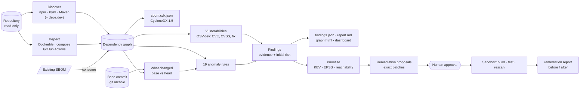

# 🛡️ Software Supply Chain Guardian (SSCG)

> **Know what you build. Trust what you ship.**
> Bosch × Amrita hackathon · Problem statement: *Software Supply Chain Guardian*
> Status: **complete workflow**: Discover → Detect → Analyze → Remediate → Validate & report

SSCG takes a repository from **discovery to verified remediation**. It scans **without installing or running anything** and answers:

> *"What is in the application, what changed, what appears risky, and how do we fix it safely?"*

* **What is in it:** every library (direct and transitive), container image, CI/CD action and build-time download, where each comes from, as a CycloneDX **SBOM** and an interactive **dependency graph**.
* **What changed:** a component-by-component comparison with the previous commit, including who changed it.
* **What appears risky:** **known vulnerabilities** (CVE, severity, fix, path back to the source) and **supply-chain anomalies** (typosquats, malicious packages, install scripts, tampered lockfiles, untrusted images, unsafe CI). Every finding carries **evidence** and an **initial risk level**.
* **How to fix it safely:** findings are **prioritised** (CISA KEV, EPSS, reachability, exposure), each gets an exact **remediation proposal** (upgrade, replace, pin, block, …), a **human approves** it, and the fix is **built, tested and rescanned in a sandbox** before a before/after **remediation report** is written.

> **Agentic AI layer:** `python -m sscg agent <repo>` runs the same pipeline as a **LangGraph multi-agent workflow**: deterministic agents wrap the modules below, a **Triage agent** (Claude, Gemini, Groq, DeepSeek or Grok) judges the suspicious changes rules cannot decide on their own, gathering more evidence when it needs it, and a **Narrator agent** writes the summary. AI output is kept apart from the evidence, grounding-checked, and falls back to rules when no API key is set. With `--remediate` the same run continues: prioritise → remediate → human approval → sandbox validation → report (**[docs/remediation.md](docs/remediation.md)**). Agent details: **[docs/agentic.md](docs/agentic.md)**.

---

## Table of contents

1. [Scope: the Guardian workflow](#1-scope-the-guardian-workflow)
2. [Quick start](#2-quick-start)
3. [How it works](#3-how-it-works)
4. [Command-line reference](#4-command-line-reference)
5. [Outputs](#5-outputs)
6. [Discover: components, SBOM, graph, containers, CI/CD](#6-discover-components-sbom-graph-containers-cicd)
7. [Detect: vulnerabilities](#7-detect-vulnerabilities)
8. [Detect: suspicious changes](#8-detect-suspicious-changes)
9. [Evidence](#9-evidence)
10. [The dashboard](#10-the-dashboard)
11. [Results on the sample applications](#11-results-on-the-sample-applications)
12. [How the results were verified](#12-how-the-results-were-verified)
13. [Repository layout](#13-repository-layout)
14. [Tech stack](#14-tech-stack)
15. [Safety and responsible use](#15-safety-and-responsible-use)
16. [Known limitations](#16-known-limitations)
17. [Prioritise, remediate and validate](#17-prioritise-remediate-and-validate)
18. [Troubleshooting](#18-troubleshooting)

---

## 1. Scope: the Guardian workflow

| Stage | Requirement (problem statement) | Status | Where |
|---|---|---|---|
| **1 · Discover** | Analyze package manifests and lockfiles; direct and transitive dependencies; names and versions | ✅ | `discover/npm.py`, `pypi.py`, `maven.py`; [deps.dev](https://deps.dev) when no lockfile exists |
| | Generate **or** consume an SBOM (CycloneDX or SPDX) | ✅ both | `sbom.py` (CycloneDX 1.5) |
| | Build the dependency graph; identify where each component originates | ✅ | `graph.py`, `export.py`; download URL / registry per component |
| | Inspect container images and CI/CD workflows | ✅ both | `discover/docker.py`, `discover/gha.py` |
| **2 · Detect** | Correlate components with known vulnerabilities; capture CVE, severity and fixes | ✅ | `vulns.py` ([OSV.dev](https://osv.dev)) |
| | Trace vulnerable transitive dependencies back to their source | ✅ | dependency paths + "introduced via" direct dependency |
| | Suspicious changes: unexpected dependency · typosquat · suspicious update · unsafe install script · untrusted image · modified lockfile | ✅ 19 rules | `rules/` + `diff.py` ("what changed"), see [§8](#8-detect-suspicious-changes) |
| | Present evidence: what, which component, dependency path, supporting evidence, initial risk | ✅ | `findings.py` → `findings.json`, `report.py` → `report.md` |
| **3 · Analyze** | Combine severity with exploitability, reachability and exposure; explainable score and confidence | ✅ | `intel.py` (CISA KEV, EPSS), `reachability.py`, `agents/prioritizer.py` |
| | Investigate non-CVE risks; keep verified evidence apart from AI inference | ✅ | `agents/triage.py` (evidence loop, grounding check) |
| **4 · Remediate** | Upgrade · replace · remove · pin · update base image · block · escalate, with risk reduction, compatibility and rollback | ✅ | `remediation.py`, `registry.py`, `agents/remediator.py` |
| | No change without human approval | ✅ | LangGraph interrupt, `python -m sscg approve`, dashboard approval board |
| **5 · Validate & report** | Apply in a sandbox; build, test, rescan; compare SBOMs; detect newly introduced problems | ✅ | `validation.py` |
| | Report: finding, approved action, build/test results, before/after risk, remaining risk, audit trail | ✅ | `remediation_report.py` |

Every scan produces `Repository → SBOM → Dependency graph → Risk detection → Evidence`. `python -m sscg agent --remediate`
continues with `Prioritized risk → Recommended fix → Human approval → Build & test → Rescan → Verified remediation`.

---

## 2. Quick start

**Requirements:** Python **3.11.4+** (developed and tested on Windows 11 with Python 3.12.4; the code is portable but macOS/Linux are untested). Node, npm, Maven and Docker are **not** needed to scan. **Node.js 18+** is needed once, to build the web dashboard; npm, Maven and Docker are used by sandbox validation when installed.

```powershell
# 1. get the code
git clone https://github.com/gshyamv/Bosch-Hackathon.git
cd Bosch-Hackathon\sscg

# 2. install dependencies (a virtual environment is optional but recommended)
python -m venv .venv
.\.venv\Scripts\Activate.ps1          # macOS/Linux: source .venv/bin/activate
pip install -r requirements.txt

# 3. scan a sample application (discover, detect, evidence)
python -m sscg scan ..\targets\sscg-demo-target

# 4. look at the results
start out\sscg-demo-target\report.md  # evidence report (also report.html, report.pdf)
start out\sscg-demo-target\graph.html # interactive graph

# 5. the web dashboard (React + FastAPI): build the UI once, then serve it
cd web; npm install; npm run build; cd ..
python -m sscg serve                  # dashboard at http://127.0.0.1:8000

# 6. optional: the agentic version (LangGraph agents + LLM triage; see docs/agentic.md)
copy .env.example .env                # then put ONE real API key (Claude, Gemini, Groq, DeepSeek or Grok) into .env
python -m sscg agent ..\targets\sscg-demo-target            # no key = rules-only fallback, still works
python -m sscg agent ..\targets\sscg-demo-target --remediate      # + prioritise, remediate, approve, validate (docs/remediation.md)
```

The repository ships with cached API responses (`sscg/.cache/`), so `--offline` works for all three sample apps without internet.

**Getting the sample applications.** `targets/sscg-demo-target` is our own test fixture. `nodejs-goof` (Snyk) and `juice-shop` (OWASP) are public, deliberately vulnerable apps. If they are missing:
```powershell
git clone --depth 1 https://github.com/snyk-labs/nodejs-goof.git targets\nodejs-goof   # scanned at commit add14ba
git clone --depth 1 https://github.com/juice-shop/juice-shop.git targets\juice-shop    # scanned at commit c9f9922
```
> All three sample apps are git repositories of their own. `sscg-demo-target` **needs its 2-commit history** for "what changed". Commit them as submodules or as plain files (keeping the demo target's `.git`), otherwise a fresh clone of this repo has empty `targets/` folders. Shallow clones (`--depth 1`) have no previous commit, so "what changed" is skipped for them.

---

## 3. How it works



**Design principles**
1. **Deterministic detection.** Parsers and rules produce facts; the same input always gives the same findings. Findings never come from AI.
2. **Evidence first.** Every finding cites a `file:line`, an advisory record, a lockfile before/after, or a git commit.
3. **Diff-aware.** "What changed" is first-class: findings that did not exist in the base commit are marked 🆕.
4. **Facts kept apart from judgement.** Official severity (CVSS) and our heuristic risk score live in separate fields, and each finding says whether it is a *verified fact* or a *heuristic*.
5. **Hostile-input safe and offline-capable.** Nothing from the scanned repo is executed; all API answers are cached.

### 3.1 The graph model

```
repo  ──►  manifest / Dockerfile / workflow  ──►  component  ──►  component  ──► …
 ★              (the "apps")                       (direct)        (transitive)
```

Components are identified by [package URL (purl)](https://github.com/package-url/purl-spec), e.g. `pkg:npm/qs@2.4.2`, so a package used by many parents appears once with many incoming edges. Depth 1 = direct dependency.

### 3.2 How each ecosystem is resolved

| Ecosystem | Input files | Transitive dependencies | Accuracy |
|---|---|---|---|
| npm | `package-lock.json` v1/v2/v3, `npm-shrinkwrap.json`, `yarn.lock` v1 | from the lockfile (Node's `node_modules` lookup rules) | exact |
| npm (no lockfile) | `package.json` | deps.dev, lowest version in each range | approximate (`deps.dev-approx`) |
| PyPI | `poetry.lock` | from the lockfile | exact |
| PyPI | `requirements*.txt` | deps.dev | exact for `==` pins, approximate otherwise |
| Maven | `pom.xml` (`${properties}`, `dependencyManagement`) | deps.dev | exact for explicit versions; parent-POM versions → `managed-by-parent` |
| Container | `Dockerfile`, `Containerfile`, `docker-compose*.yml` | static parsing | exact |
| CI/CD | `.github/workflows/*.yml` | static parsing | exact |

---

## 4. Command-line reference

```
python -m sscg scan <repo> [--out DIR] [--base REV | --no-diff] [--no-vulns] [--sbom FILE] [--offline]
                           [--why NAME ...] [--focus NAME] [--max-depth N] [--top N]
```

Run from inside the `sscg/` folder.

| Option | Meaning |
|---|---|
| `<repo>` | Folder to scan. It is only read; nothing is installed, built or executed. |
| `--out DIR` | Output folder (default `out/<repo name>/`). |
| `--base REV` | Commit to compare with for "what changed" (default `HEAD~1`). |
| `--no-diff` | Skip the comparison. |
| `--no-vulns` | Skip vulnerability detection (no OSV calls). |
| `--sbom FILE` | **Consume** a CycloneDX JSON SBOM instead of scanning manifests. |
| `--offline` | Answer every API call from `.cache/`. |
| `--why NAME …` | Print every dependency path that pulls `NAME` into the app. |
| `--focus NAME` | `graph.html` shows only that package, its dependents and its dependencies. |
| `--max-depth N` | `graph.html` shows only N levels (above 600 nodes it is cut to 2 automatically; vulnerable and suspicious nodes are always kept). |
| `--top N` | How many top findings to print (default 15). |

```powershell
python -m sscg scan ..\targets\sscg-demo-target                       # everything, compares with HEAD~1
python -m sscg scan ..\targets\sscg-demo-target --base bf0e651        # compare with a specific commit
python -m sscg scan ..\targets\nodejs-goof --why qs --focus qs        # trace qs
python -m sscg scan ..\targets\juice-shop --offline                   # no network
```

<details>
<summary><b>Sample terminal output</b> (sscg-demo-target)</summary>

```
=== Guardian scan: sscg-demo-target ===
  ① components      : 31 (25 libraries: 13 direct, 12 transitive, depth 2) · 1 images · 3 CI actions
  ② SBOM            : 36 components (CycloneDX 1.5)
  what changed      : bf0e651 -> 8cad42e by fastbuilds42 (FIRST-TIME contributor): "chore: routine dependency refresh"; 6 files, +7 / -1 / ~1 components
  ③ vulnerabilities : 16 vulnerable components (141 advisories)
  ④ anomalies       : 25  (R08_UNEXPECTED_DEPENDENCY 3, R03_INSTALL_SCRIPT 2, R13_CONTAINER_HARDENING 2, R01_TYPOSQUAT 2, ...)
  ⑤ findings        : 41 · Critical 21 · High 8 · Medium 12 · Low 0 · Info 0 · new in change 25
    F-001 Critical 10.0  NEW 'postinstall' script scripts/setup.js runs shell commands / child processes, reads secrets from the environment, ...
    F-002 Critical 10.0  NEW .github/workflows/ci.yml: 'pull_request_target' workflow checks out the pull request's own code
    F-003 Critical 10.0  NEW .github/workflows/ci.yml: secret(s) NPM_TOKEN are passed to a downloaded script
    F-004 Critical 10.0  NEW crossenv@7.0.3 is a documented malicious package
    F-005 Critical 10.0  NEW lodash@4.17.15: same version, different content hash (and source) in package-lock.json
    F-006 Critical 10.0  NEW python3-dateutil@2.8.1 is a documented malicious package
    F-007 Critical 10.0      org.apache.logging.log4j:log4j-core@2.14.1: 8 known vulnerabilities (highest CRITICAL, CVSS 10.0)
    ...
```
</details>

---

## 5. Outputs

Every scan writes to `out/<repo name>/`:

| File | Stage | Content |
|---|---|---|
| `sbom.cdx.json` | discover | **CycloneDX 1.5 SBOM**: every component with purl, version, scope, hashes, origin, and the full dependency tree |
| `graph.html` | discover | Interactive graph (offline). Red = published advisories, ◆ = suspicious. |
| `graph.json` | discover | All nodes and edges with every attribute (incl. advisories and finding IDs) |
| `summary.json` | discover | Counts, depth, origins, duplicates, blast radius, container and CI inventory, finding counts |
| `findings.json` | detect | **All findings** with evidence, severity, fixes, paths and risk, plus the "what changed" comparison |
| `report.md` | evidence | **Human-readable evidence report**: what is in it, what changed, what appears risky, evidence per finding |
| `report.html` · `report.pdf` | evidence | The same report as a standalone web page (offline, light/dark) and an A4 PDF, rendered from `report.md` by `report_export.py` |
| `graph.mmd` | discover | Mermaid diagram (graphs ≤ 80 nodes) |
| `agentic.json` | analyze | `agent` command: AI triage, tool evidence, summary, agent runs and audit trail |
| `remediation/pending.json` | remediate | `--remediate`: the proposals of a run waiting for human approval |
| `remediation/remediation_report.{md,html,pdf}` | validate & report | finding → approved action → build/test → before/after risk → remaining risk → audit trail |
| `remediation/remediation.json` · `remediation.patch` | validate & report | the same, machine-readable, and every approved change as one patch |

---

## 6. Discover: components, SBOM, graph, containers, CI/CD

### 6.1 SBOM (generate and consume)

**Generate:** every scan writes `sbom.cdx.json` in **CycloneDX 1.5 JSON**:

| Component | CycloneDX `type` | Identity (`purl`) | Origin (`externalReferences`) | Hashes |
|---|---|---|---|---|
| npm / PyPI / Maven package | `library` | `pkg:npm/qs@2.4.2` … | lockfile `resolved` URL | SHA-512 / SHA-1 from lockfile `integrity` |
| Container image | `container` | `pkg:docker/library/node@18.13.0?repository_url=docker.io` | `docker://docker.io/library/node` | SHA-256 if pinned by digest |
| GitHub Action | `application` | `pkg:github/actions/checkout@v4` | `https://github.com/actions/checkout` (vcs) | — |
| File downloaded while building | `file` | — | the URL | — |
| Manifest / Dockerfile / workflow | `application` | `bom-ref` = `app:<path>` | — | — |

Scope: `required` = runtime, `optional`, `excluded` = dev/test/build/CI only. Facts CycloneDX has no field for are kept as `sscg:*` properties (`sscg:direct`, `sscg:depth`, `sscg:source`, `sscg:pinned_to_sha`, `sscg:pinned_by_digest`, `sscg:runs_as` …). An integrity value that is not a well-formed hash is kept as `sscg:integrity_malformed`, never emitted as a hash.

**Consume:** `python -m sscg scan <repo> --sbom bom.cdx.json` rebuilds the graph from an SBOM (ours, Syft, cdxgen …) and runs the same pipeline. SBOMs written by SSCG come back identical (verified).

### 6.2 Container inspection (`Dockerfile`, `Containerfile`, `docker-compose*.yml`)

| Recorded | Details |
|---|---|
| Base images (`FROM`) | registry, repository, tag, digest; official Docker Hub image or not; pinned by digest or not; `--platform` and `ARG` defaults handled |
| Build stages | the final stage **and every stage it is built on** ship (`scope: prod`, e.g. `FROM base AS production`); other stages are `build` |
| Remote files | URLs fetched with `RUN curl/wget` or `ADD <url>` (across `\` continuations) |
| Runtime user | the `USER` in effect for the final stage, inherited along the stage chain |
| Compose services | images of pulled services; services with `build:` are skipped (their Dockerfile is scanned) |

### 6.3 CI/CD inspection (GitHub Actions)

Triggers, token `permissions`, every `uses:` action with its ref and whether it is pinned to a **full commit SHA**, job container and service images, `docker://` actions, files fetched in `run:` steps (URLs with `${{ }}` kept whole), each with its own `file:line`.

---

## 7. Detect: vulnerabilities

| Step | How |
|---|---|
| **Correlate** | Every npm / PyPI / Maven package version is sent to OSV.dev `querybatch` (name + version only). |
| **Capture** | For each advisory: OSV/GHSA ID, **CVE aliases**, summary, **CVSS vector**, **CVSS v3 base score** (computed with the FIRST formula; checked against reference vectors), or the advisory's severity label when only CVSS v4 / no vector is published, and the **fixed version** for the installed version's range. |
| **De-duplicate** | The same issue published as GHSA + PYSEC + CVE is counted once (alias matching). |
| **Trace** | Up to 3 shortest **dependency paths** from the app to the vulnerable package, plus the **direct dependency that introduces it** ("introduced via"). |
| **Fix** | Per advisory `fixed_in`, plus the lowest version that fixes all of them (`upgrade_to_at_least`), and the list of advisories without a published fix. |

One finding is created **per vulnerable component** (not per advisory). Its type is *Vulnerable direct dependency* or *Vulnerable transitive dependency*, the two categories from the slide.

Example (sscg-demo-target):
```
F-007  org.apache.logging.log4j:log4j-core@2.14.1: 8 known vulnerabilities (highest CRITICAL, CVSS 10.0)
       path: com.acme:notifier@1.0.0 → log4j-core@2.14.1
       GHSA-jfh8-c2jp-5v3q  CVE-2021-44228 (Log4Shell)  CRITICAL  CVSS 10.0  fixed in 2.15.0
       GHSA-7rjr-3q55-vv33  CVE-2021-45046              CRITICAL  CVSS 9.0   fixed in 2.16.0
       ...                                              → upgrade to ≥ 2.25.4 fixes all 8
F-009  minimist@0.0.8 (transitive): acme-orders → mkdirp@0.5.1 → minimist@0.0.8   introduced via mkdirp
```

**OSV `MAL-*` records** (known malicious packages) are not treated as vulnerabilities; they become rule R02 (suspicious changes).

---

## 8. Detect: suspicious changes

### 8.1 What changed

When the repository has history, SSCG extracts the **base commit** (default `HEAD~1`) with `git archive` into a temporary folder. Nothing is checked out or run. It scans the base with the same code and compares component by component:

* **commit metadata:** author, date, message, and whether this is the author's **first commit** in the repository
* **files changed** (`git diff --name-status`)
* components **added**, **removed**, and **changed**: a new version, or the *same* version with a different download URL, integrity hash or install-script flag

All rules then run on **both** sides. A finding that did not exist in the base is marked **🆕 new in this change** and gets `introduced_in = <commit>`.

### 8.2 The 19 rules

| Rule | Slide category | Detects | Default level |
|---|---|---|---|
| R01 `TYPOSQUAT` | Typosquatted package | direct dependency whose name equals a popular package once separators / `python-`·`node-` prefixes are removed, or is 1 edit (2 for long names) away from one | High |
| R02 `KNOWN_MALICIOUS` | Typosquatted package | OSV `MAL-*` record, or entry in the documented-incidents list `data/known_malicious.json` | Critical |
| R03 `INSTALL_SCRIPT` | Unsafe install script | `preinstall/install/postinstall/prepare` in the app's `package.json` (Medium); third-party package with `hasInstallScript` (Low) | Medium / Low |
| R04 `INSTALL_SCRIPT_CONTENT` | Unsafe install script | the app's install script contains child processes, secret-looking env names, base64-hidden data (decoded in the evidence), `eval`, network access, host fingerprinting | High (≥ 2 kinds: Critical) |
| R05 `LOCKFILE_UNTRUSTED_SOURCE` | Modified lockfile | npm package downloaded from a host other than the npm registry | High |
| R06 `LOCKFILE_INTEGRITY_CHANGED` | Modified lockfile | **same name and version, different integrity hash** vs. the base commit (tarball swap) | Critical |
| R07 `LOCKFILE_DRIFT` | Modified lockfile | lockfile entry of a direct dependency changed while `package.json` did not | High |
| R08 `UNEXPECTED_DEPENDENCY` | Unexpected dependency | new direct dependency vs. the base commit | Medium |
| R09 `UNPINNED_DEPENDENCY` | Suspicious package update | `requirements.txt` line without `==`; npm spec `latest`/`*`/git/URL; `package.json` without lockfile (one finding per manifest) | Low (no lockfile: Medium) |
| R10 `UNTRUSTED_BASE_IMAGE` | Untrusted image | image not from `docker.io/library`, `gcr.io/distroless`, `mcr.microsoft.com`, `cgr.dev/chainguard` | High |
| R11 `MUTABLE_IMAGE_TAG` | Untrusted image | `latest` or no tag, and no digest | Medium |
| R12 `REMOTE_SCRIPT_EXEC` | Unsafe install script | `curl`/`wget … \| sh` in a Dockerfile `RUN` or a workflow `run:` | High |
| R13 `CONTAINER_HARDENING` | Untrusted image | `npm install/ci/update` without `--ignore-scripts` in a Dockerfile (Medium); no `USER` (Low) | Medium / Low |
| R14 `CI_PWN_REQUEST` | Unsafe CI/CD component | `pull_request_target` + checkout of the PR's head ref | Critical |
| R15 `CI_UNPINNED_ACTION` | Unsafe CI/CD component | third-party action (owner not `actions`/`github`) not pinned to a commit SHA | High |
| R16 `CI_EXCESSIVE_PERMISSIONS` | Unsafe CI/CD component | `permissions: write-all` (High); no top-level `permissions:` (Low) | High / Low |
| R17 `CI_SECRET_EXPOSURE` | Unsafe CI/CD component | `secrets.*` handed to a step that pipes a download into a shell, or to an unpinned third-party action | Critical |
| R18 `NEW_AUTHOR_SENSITIVE_CHANGE` | Suspicious package update | a **first-time contributor** changed lockfiles, manifests, Dockerfiles, workflows or install scripts | High |
| R19 `SUSPICIOUS_UPDATE` | Suspicious package update | a version update that also adds an install script or changes the download host | High |

All six example categories from the slide are covered: **unexpected dependency** (R08), **typosquatted package** (R01, R02), **suspicious package update** (R09, R18, R19), **unsafe install script** (R03, R04, R12), **untrusted image** (R10, R11, R13), **modified lockfile** (R05, R06, R07). The CI/CD rules (R14–R17) cover slide 3's "unpinned or unsafe CI/CD component".

Wording follows "investigate, not accuse": rule findings describe what was observed; only R02 states that a package *is* malicious, and only when a published record says so.

---

## 9. Evidence

Every finding in `findings.json` answers the slide's five questions:

| Slide asks | Field(s) | Example (F-005) |
|---|---|---|
| **What was detected** | `title`, `type`, `rule` | "lodash@4.17.15: same version, different content hash (and source)" · Modified lockfile · R06 |
| **Which component** | `component` (purl, ecosystem, scope, direct), `location` | `pkg:npm/lodash@4.17.15`, direct, prod · `package-lock.json:51` |
| **Dependency path** | `dependency_paths`, `introduced_by` | `acme-orders@1.0.0 → lodash@4.17.15` |
| **Supporting evidence** | `evidence[]`: `file` (path, line, snippet) · `advisory` (ID, CVEs, CVSS, fix, link) · `change` (base → head values) · `commit` (sha, author, message) · `reference` · `fact` | integrity `sha512-…` → `sha512-…`, resolved `registry.npmjs.org` → `npm-mirror.example.invalid`, commit `8cad42e` by fastbuilds42 |
| **Initial risk level** | `risk` (score 0–10, level, factors, reasons) | Critical (10.0): R06 default Critical + introduced in the latest change |

Plus: `severity` and `fixes` (vulnerabilities only, official data), `why_it_matters`, `classification` (`verified_fact` / `heuristic`), `confidence` (`high` / `medium`), `new_in_change`, `introduced_in`.

### 9.1 Initial risk (explainable)

> **Guardian initial risk (heuristic, 0–10); not a CVSS score.** Official severity stays in `severity`.

| Finding | Starting score |
|---|---|
| Vulnerability | highest **CVSS v3** score of its advisories; if none, the advisory label: Critical 9.5 · High 8.0 · Medium 5.5 · Low 3.0 · unknown 5.5 |
| Anomaly | the rule's level: Critical 9.5 · High 8.0 · Medium 5.5 · Low 3.0 |
| **+1.0** | if the finding is **new in the latest change** |

Level: **≥ 9 Critical · ≥ 7 High · ≥ 4 Medium · ≥ 2 Low · else Info**. Every finding lists its `reasons` (e.g. *"highest advisory severity CRITICAL (CVSS 10.0)"*, *"introduced in the latest change"*, *"version estimated without a lockfile"*, *"2 advisories without a published fix"*).

### 9.2 The report

`report.md` answers three questions, then lists the evidence:
1. **What is in the application:** inventory and SBOM
2. **What changed:** base → head, author (first-time?), files, components added / removed / changed, number of new findings
3. **What appears risky:** counts per level and one table row per finding (risk, type, finding, location, 🆕)
4. **Evidence per finding:** the five answers above for the top 60 findings (all are in `findings.json`)
5. **Notes and limits**

---

## 10. The dashboard

A React single-page app (`sscg/web`, Vite + TypeScript + Tailwind CSS) served by a small FastAPI server (`sscg/sscg/server.py`).

```powershell
cd sscg\web
npm install
npm run build          # once, and after UI changes: writes sscg/web/dist
cd ..
python -m sscg serve   # http://127.0.0.1:8000  (--port N to change it)
```

For UI development, run `python -m sscg serve` and, in a second terminal, `npm run dev` in `sscg/web` (http://localhost:5173, hot reload, `/api` is proxied to port 8000).

📖 A walkthrough of every page is in **[docs/dashboard.md](docs/dashboard.md)**.

| Page | Shows |
|---|---|
| **New run** (button) | repository picker (sample apps or any folder), pipeline (detect with rules only · detect + AI agents · full detect → remediate), LLM provider (shows which keys are set, never the keys), compare-with commit, graph focus, OSV, offline. Runs as a background job with a **live console** |
| **Overview** | the five stages Discover → Detect → Analyze → Remediate → Validate with their status; KPIs; findings by level / type; components by ecosystem; AI summary; top findings; what changed; remediation status |
| **Supply chain** | interactive dependency graph (by level · direct only · one dependency's tree · full risk graph); libraries per level; blast radius; **Why is this package here?**; SBOM table + download; container images & CI/CD; origins and install scripts |
| **Vulnerabilities** | filterable table (severity, direct/transitive, CVEs, CVSS, fix, introduced via, risk); click a row for paths and the advisory table |
| **Suspicious changes** | what changed (commit, author, first-time flag, files, component changes) + anomaly table |
| **Evidence** | every finding, filterable; a side panel with component, dependency path, evidence, initial risk, priority and the separated AI triage; downloads |
| **AI triage** | narrative, verdicts, grounding check, tool evidence per finding, LLM usage and agent runs |
| **Remediation** | while a run is paused: **the human-approval board** (per-proposal approve / reject / accept risk / request changes, bulk actions, diffs, approver + reason) → validation job. Afterwards: verdict, prioritised risks, proposals & decisions, build/test/rescan before vs after, SBOM diff, new findings, report |
| **Reports** | all output files (JSON, CycloneDX, Markdown, HTML, PDF, patch) and an inline preview of the evidence and remediation reports |

The server listens on `127.0.0.1` only. It reads `out/<repo>/` and starts the same CLI commands you would type (`scan`, `agent`, `approve`), so the dashboard can do nothing the CLI cannot. Report and graph pages are shown in sandboxed iframes.

---

## 11. Results on the sample applications

### 11.1 `targets/sscg-demo-target`: our multi-ecosystem fixture (with history)

A small "orders" service (npm + Python worker + Java notifier + Dockerfile + CI) with two commits. The second, by a new contributor, is titled *"chore: routine dependency refresh"*.

| | |
|---|---|
| Inventory | 31 components: 25 libraries (npm 7, PyPI 10, Maven 8; 13 direct / 12 transitive), 1 image, 3 CI actions, 2 downloads · SBOM 36 components |
| What changed | `bf0e651` → `8cad42e` by **fastbuilds42 (first-time contributor)** · 6 files · +7 / −1 / ~1 components |
| Vulnerabilities | **16 vulnerable components, 141 advisories**, incl. Log4Shell (CVE-2021-44228, CVSS 10.0), jackson-databind (60 advisories), minimist via mkdirp (CVSS 9.8) |
| Anomalies | **25, all new in the change** |
| Findings | **41**: 21 Critical · 8 High · 12 Medium · **25 new** |

What a "routine dependency refresh" really did, and what SSCG found:

| Planted in `8cad42e` | Found as |
|---|---|
| `crossenv` (typosquat of `cross-env`, real 2017 malicious package) | R01 + R02 + R08 + R03 |
| `postinstall` → `scripts/setup.js` with `child_process`, token names, a base64-hidden URL | R03 + **R04 Critical**, endpoint decoded: `http://telemetry.example.invalid/c` |
| lodash moved to `npm-mirror.example.invalid`, **same version, new hash** | R05 + **R06 Critical** + R07 |
| `python3-dateutil` (typosquat of `python-dateutil`, real 2019 malicious package) | R01 + R02 + R08 |
| `urllib3` without a version | R08 + R09 |
| base image → `fastbuilds42/node:latest`, `curl … \| sh`, `USER` removed, `npm install` with scripts | R10 + R11 + R12 + R13 ×2 |
| CI → `pull_request_target` + PR checkout, `write-all`, `fastbuilds42/cache-helper@main`, `NPM_TOKEN` to `curl … \| bash` | **R14 + R16 + R15 + R12 + R17** |
| all of it by a first-time author | R18 |

### 11.2 `targets/nodejs-goof`: Snyk's deliberately vulnerable Node.js app (shallow clone)

| | |
|---|---|
| Inventory | 989 components: **980** npm packages (35 direct / 945 transitive, depth 10), 3 images, 6 CI actions · SBOM 996 components |
| Vulnerabilities | **139 vulnerable components, 315 advisories**. `qs` ships in 3 versions via 3 parents: `express@4.12.4`, `body-parser@1.9.0`, `tap → coveralls → request` |
| Anomalies | 15: 4 third-party install scripts, 4 workflows without `permissions:`, `snyk/actions/setup@master` unpinned (×2), Dockerfile runs `npm update`/`npm install` with scripts and as root, `morgan`/`method-override` requested as `latest` |
| Findings | **154**: 24 Critical · 73 High · 37 Medium · 20 Low |

### 11.3 `targets/juice-shop`: OWASP Juice Shop (large, no lockfile, shallow clone)

| | |
|---|---|
| Inventory | 1,790 components: **1,754** npm packages (155 direct / 1,599 transitive, depth 9), 8 images (6 shipped, 2 build-only), 25 CI actions (18 pinned to a SHA), 3 downloads · SBOM 1,813 components |
| Vulnerabilities | 55 vulnerable components, 139 advisories (**over-estimate**: no lockfile, see below) |
| Anomalies | 28: `GITHUB_TOKEN` passed to the unpinned third-party actions `coverallsapp/github-action@v2` and `calibreapp/image-actions` (R17), Heroku installer piped into a shell (R12), 3 unpinned third-party actions, 13 workflows without `permissions:`, `latest` images, 2 manifests without a lockfile |
| Findings | **83**: 7 Critical · 29 High · 27 Medium · 20 Low |

**Accuracy without a lockfile.** We generated a real lockfile for the backend in a scratch copy (`npm install --package-lock-only --ignore-scripts`: metadata only) and compared it with the estimate: package **names 99.7 %** identical, exact **versions 88 %**, packages with advisories **37 estimated vs 22 real**. The estimate takes the lowest version each range allows, so it skews older and over-counts vulnerabilities. Such findings are marked `confidence: medium`.

---

## 12. How the results were verified

| Check | How | Result |
|---|---|---|
| **Ground truth (detect, evidence)** | the 9 planted anomalies and the vulnerability list in `docs/blueprint.md` §7.2–7.3 | ✅ all 9 anomalies, all listed vulnerable components (Log4Shell, Text4Shell, minimist, follow-redirects, …) |
| **Ground truth (discover)** | expected components in `docs/blueprint.md` §7.1 | ✅ npm 7, image, 3 actions |
| **CVSS calculator** | 7 reference CVSS 3.0/3.1 vectors (incl. 10.0, 9.8, 0.0, scope-changed cases) | ✅ 7/7 |
| **Fix-version logic** | multiple ranges, `last_affected`, open ranges, pre-releases, 4-part / qualifier versions | ✅ |
| **"New in change" logic** | compare HEAD with itself | ✅ 0 new findings, change-only rules silent |
| **Typosquat false positives** | all 190 direct dependencies of nodejs-goof and juice-shop | ✅ 0 flagged |
| **SBOM validity** | official CycloneDX 1.5 JSON schema, all 3 targets | ✅ 0 errors |
| **Generate → consume round-trip** | write SBOM, read back with `--sbom`, compare graphs | ✅ identical on all 3 |
| **Regression** | graph vs. the first builder (`archive/depgraph-v0`) | ✅ 0 diffs |
| **Cross-check with npm** | nodejs-goof vs `npm ls` | ✅ 980 packages, 35 direct, depth 10 |
| **Container / CI parser edge cases** | hand-written fixture (ARG in FROM, multi-stage chains, inherited USER, digest-only images, reusable workflows, SHA pins, `docker://`, `${{ }}` URLs …) | ✅ 16/16 |
| **Offline mode** | rerun with `--offline` | ✅ identical findings |
| **Dashboard** | API smoke test (FastAPI `TestClient`, path-traversal attempts); headless Chrome (Puppeteer) through every page; full run → approval → sandbox validation driven through the API | ✅ all pages render, no console errors; run verified |

---

## 13. Repository layout

```
Bosch-Hackathon/
├── README.md                     ← this file
├── Amrita_BD Hackathon_Problem_Statement (1).pdf
├── sscg/                         ← the solution
│   ├── README.md                 short quick-start
│   ├── requirements.txt
│   ├── sscg/
│   │   ├── __main__.py           CLI: python -m sscg scan | agent | approve | serve
│   │   ├── server.py             FastAPI backend of the web dashboard (JSON API + background jobs)
│   │   ├── pipeline.py           build · detect · emit: the pipeline steps shared by scan and the agents
│   │   ├── model.py              graph model (DepGraph, purl)
│   │   ├── cache.py              cached HTTP (deps.dev, OSV) for offline use
│   │   ├── discover/             ① npm.py · pypi.py · maven.py · depsdev.py   ② docker.py · gha.py
│   │   ├── sbom.py               ② CycloneDX 1.5 generate + consume
│   │   ├── graph.py              ② depth, paths, origins, inventory, summary
│   │   ├── export.py             ② graph.html / graph.json / graph.mmd
│   │   ├── vulns.py              ③ OSV: advisories, CVEs, severity, fixes, de-duplication
│   │   ├── cvss.py               ③ CVSS v3.x base score
│   │   ├── versions.py           ③ version comparison, fixed version per range
│   │   ├── gitutil.py            ④ read-only git helpers (commit info, git archive)
│   │   ├── diff.py               ④ what changed: base vs head
│   │   ├── rules/                ④ common.py (catalogue) · packages.py · lockfile.py · container.py · cicd.py · provenance.py
│   │   ├── data/                 ④ popular_npm.txt · popular_pypi.txt · known_malicious.json
│   │   ├── findings.py           ⑤ finding envelope, paths, initial risk, counts
│   │   ├── report.py             ⑤ report.md (+ the separate AI section when the agents ran)
│   │   └── agents/               LangGraph agents (docs/agentic.md): graph · workers · triage · narrator · prioritizer · remediator · remediation_flow
│   │                             · tools · guard · kb + knowledge/ (playbooks, attack patterns, policy) · llm · config
│   ├── .env.example              LLM keys template (copy to .env, which is git-ignored)
│   ├── web/                      React dashboard (Vite + TypeScript + Tailwind): src/pages · src/components
│   ├── .cache/                   cached API responses
│   └── out/<repo>/               scan results
├── targets/                      sample applications (scanned, never run)
│   ├── sscg-demo-target/  ·  nodejs-goof/  ·  juice-shop/
├── docs/                         agentic.md · blueprint.md · graph_blueprint.md · dashboard.md · report.md · screenshots/
└── archive/                      earlier prototypes (depgraph-v0, npm-ls-prototype, streamlit-ui)
```

---

## 14. Tech stack

| Layer | Tool | Used for |
|---|---|---|
| Language | Python 3.12 | everything |
| Graph | networkx 3.4 | graph model, paths, ancestors/descendants |
| Visualisation | pyvis 0.3 (vis-network) | `graph.html` |
| Dashboard UI | React 18 + TypeScript 5 · Vite 5 · Tailwind CSS 3 · Recharts · lucide-react | `sscg/web` |
| Dashboard API | FastAPI + uvicorn | `sscg/sscg/server.py` (`python -m sscg serve`) |
| Parsing | `json`, `tomllib`, `xml.etree`, PyYAML 6 | manifests, lockfiles, workflows, compose |
| Similarity | rapidfuzz 3 (Levenshtein) | typosquat rule R01 |
| Versions | packaging 24 (PEP 440) + fallback | fixed-version selection |
| HTTP | requests | API calls (cached on disk) |
| Git | git CLI (`log`, `diff`, `archive`) | what changed, commit evidence |
| Standards | CycloneDX 1.5 · purl · CVSS v3.1 (FIRST) | SBOM, identities, scoring |
| Data | [OSV.dev](https://osv.dev) · [deps.dev](https://deps.dev) (free, no key) | advisories incl. `MAL-*`; transitive resolution |
| Agents | LangGraph 0.4 (StateGraph, Send, interrupt, MemorySaver) + pydantic 2 | orchestration, parallel triage, human approval, typed contracts |
| LLMs | official SDKs: `anthropic` (Claude) · `google-genai` (Gemini) · `openai` → Groq, DeepSeek and xAI (Grok) APIs | triage + summary (`agent` command only) |

---

## 15. Safety and responsible use

* **Static analysis only.** SSCG reads files. It never runs `npm install`, `pip install`, `mvn`, `docker build`/`pull` or a workflow. The base commit is read with `git archive` and extracted with Python's safe `data` filter (no absolute paths, no links outside the folder).
* **Hostile input.** Text from scanned repos is escaped in `graph.html`; detectors only read files inside the repository (path-traversal guard); a broken file or detector never stops the scan.
* **Network:** only OSV.dev and deps.dev, with package names and versions only, never source code. `--offline` disables all network access.
* **No credentials** are needed, read or stored. The install-script rule *reports* secret-looking names it finds in code; it never reads environment variables.
* **Findings never come from AI.** All findings are deterministic and reproducible. Each says whether it is a *verified fact* (e.g. a hash changed) or a *heuristic* (e.g. a name looks like a typosquat). The optional `agent` command adds AI *inference* in a separate place (`agentic.json`, report section "AI triage"): redacted evidence packets only, grounding-checked, never changes a finding or its risk score. See [docs/agentic.md §7](docs/agentic.md#7-responsible-ai-and-security).
* **Within the hackathon rules:** free, open-source sample apps; scanning only inside our sandbox; nothing published to registries; no automatic changes.

---

## 16. Known limitations

| Limitation | Effect |
|---|---|
| No lockfile (npm / PyPI) and Maven | versions estimated via deps.dev (lowest version in range). Measured on Juice Shop: names ~99.7 % right, versions 88 %, advisories over-counted (37 vs 22); such findings say `confidence: medium` |
| Shallow clones / first commit | no previous commit, so "what changed" and the 🆕 marking are skipped (noted in the report) |
| Container images | inspected from Dockerfile/compose, not pulled: OS packages inside images and their CVEs are not covered |
| Third-party install scripts | only the lockfile flag is known (package code is not downloaded); R04 inspects the **application's own** install scripts |
| Typosquat (R01) | name similarity against a bundled list of ~300 npm and ~200 PyPI names; scoped npm names are not checked; needs human review |
| Known malicious (R02) | OSV `MAL-*` records + a small seed list of documented incidents; not a complete malware feed |
| Severity | CVSS v3 is scored; CVSS v4-only / v2-only advisories use the published label |
| Initial risk | a heuristic from severity and evidence; exploitability (KEV/EPSS), reachability and exposure are added by prioritisation (`--remediate`) |
| CI/CD | GitHub Actions only |
| npm peer dependencies | not drawn as edges |
| Large graphs | `graph.html` cut to 2 levels above 600 nodes (vulnerable / suspicious nodes kept); JSON and SBOM always complete |

---

## 17. Prioritise, remediate and validate

See **[docs/remediation.md](docs/remediation.md)**. One LangGraph run takes findings from detection to verified remediation:

1. **Prioritize:** CISA KEV, EPSS, import-level reachability and exposure feed an explainable score (P0–P3, urgent,
   confidence).
2. **Investigate:** the triage agent with its evidence loop.
3. **Recommend:** a safe version (fewest remaining OSV advisories, installable) and an exact patch per package or file,
   with risk reduction, compatibility and rollback, plus an optional grounded LLM rationale.
4. **Human approval:** the run pauses (LangGraph interrupt with a SQLite checkpoint). Decide with
   `python -m sscg approve` or in the dashboard.
5. **Validate:** in a sandbox copy, build and test before and after (npm/pip/Maven/Docker, install scripts off,
   secrets scrubbed), rescan, then compare.
6. **Report:** `out/<repo>/remediation/remediation_report.{md,html,pdf}`, `remediation.json`, `remediation.patch`.

```powershell
python -m sscg agent ..\targets\sscg-demo-target --remediate --decisions later
python -m sscg approve ..\targets\sscg-demo-target --approve all-patchable --by "Your Name"
```

---

## 18. Troubleshooting

| Problem | Fix |
|---|---|
| `No module named sscg` | run the command from inside the `sscg/` folder |
| `No module named rapidfuzz` / `packaging` | `pip install -r requirements.txt` |
| `extractall() got an unexpected keyword argument 'filter'` | Python older than 3.11.4: upgrade (3.12 recommended) |
| `base revision 'HEAD~1' not found` | shallow clone or single commit: fetch history (`git fetch --deepen=1`) or pass `--base <commit>` |
| `OSV unavailable` / no vulnerabilities | no network: rerun with `--offline` (uses the cache) or check the connection |
| Slow first scan | the first run fetches advisory details and deps.dev data; later runs use `.cache/` |
| `graph.html` looks cut off | large graph: use `--focus <package>` or `--max-depth N` |
| Dashboard shows old results | click **Scan repository** again; results are read from `out/<repo>/` |
