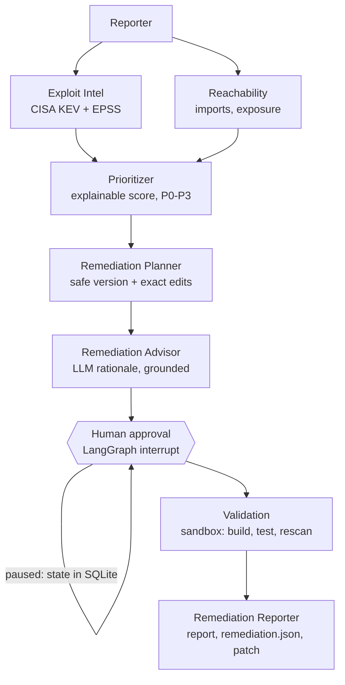

# Remediation: from finding to verified fix

*How the Guardian takes a finding from detection to verified remediation, for any scanned application.*

---

## 0. In short

The question: *"How does the Guardian take a finding from detection to verified remediation?"*
We do it in **one LangGraph run** that pauses for a human:

```
Prioritized risk  ->  Recommended fix  ->  Human approval  ->  Build & test  ->  Rescan  ->  Verified remediation
 (KEV, EPSS,          (exact patch,         (LangGraph          (sandbox,        (detection  (before / after,
  reachability)        safe version)         interrupt)          before/after)    pipeline)   report + patch)
```

```powershell
cd sscg
# 1. detect, prioritise and propose fixes up to the approval gate; the run pauses and is saved to disk
python -m sscg agent ..\targets\sscg-demo-target --remediate --decisions later
# 2. a human decides, in another process or the dashboard; the run resumes: sandbox build, test, rescan, report
python -m sscg approve ..\targets\sscg-demo-target --approve all-patchable --by "Your Name"
# or interactively in one go
python -m sscg agent ..\targets\sscg-demo-target --remediate           # asks per proposal on the console
python -m sscg serve                                             # dashboard: New run -> "Full: detect -> remediate", approve on the Remediation page
```

Outputs are in `out/<repo>/remediation/`: `remediation_report.md/.html/.pdf`, `remediation.json` (machine-readable),
`remediation.patch` (everything that changed, including regenerated lockfiles) and, while paused, `pending.json`.
**The original repository is never modified.** All changes happen in a sandbox copy.

Nothing is application-specific. npm, PyPI, Maven, Dockerfiles and GitHub Actions are handled wherever they are in
the repository.

---

## 1. The graph



| Node | Kind | File |
|---|---|---|
| `exploit_intel` | deterministic, parallel with reachability | `agents/prioritizer.py` + `sscg/intel.py` |
| `reachability_scan` | deterministic | `agents/prioritizer.py` + `sscg/reachability.py` |
| `prioritize` | deterministic | `agents/prioritizer.py` |
| `plan_remediation` | deterministic | `agents/remediator.py` + `sscg/remediation.py`, `sscg/registry.py` |
| `advise_remediation` | **LLM** (optional) | `agents/remediator.py` |
| `human_approval` | **human** (interrupt) | `agents/remediation_flow.py` |
| `validate` | deterministic | `agents/remediation_flow.py` + `sscg/validation.py` |
| `remediation_report` | deterministic | `agents/remediation_flow.py` + `sscg/remediation_report.py` |

---

## 2. Prioritize risks: "focus on what truly matters"

**Exploitability** (`sscg/intel.py`). Every CVE alias of every vulnerability finding is looked up in:
* **CISA KEV**: the CVE is exploited in the wild (including the "known ransomware use" flag);
* **FIRST EPSS**: the probability of exploitation in the next 30 days, and its percentile.

Both are free and need no key. They are cached per day (`cache.http_json_daily`), and offline runs use the newest
cached copy.

**Reachability** (`sscg/reachability.py`). This is a static, import-level check of JS/TS, Python and Java/Kotlin
source. Nothing is executed.

| Status | Meaning |
|---|---|
| `imported` | application (non-test) code imports it, with file:line evidence |
| `referenced` | not imported, but named in code: packages loaded by name, e.g. `app.set('view engine', 'ejs')` or TypeORM's `type: 'mysql'` |
| `transitive` | pulled in by an imported or referenced dependency, so potentially reachable |
| `tests_only` | imported only from test code |
| `not_imported` | declared, but no application code imports it or a parent |
| `unknown` | containers, CI actions, URLs, or no source files for that ecosystem |

**Exposure.** Production vs dev/test scope, plus whether the app is a **network service** (HTTP server patterns,
Dockerfile `EXPOSE`).

**Score.** initial risk plus signed points. It is deterministic, and each point is listed with its reason in
the report.

| Factor | Points |
|---|---|
| In CISA KEV / with ransomware use | +2.0 / +2.5 |
| EPSS ≥ 0.5 / ≥ 0.1 / < 0.01 | +1.0 / +0.5 / −0.5 |
| Reachability: imported / tests only / not imported | +0.5 / −1.5 / −2.0 |
| Dev/test/build-only / shipped in a network service | −1.5 / +0.5 |
| Triage (anomalies): likely malicious / suspicious / likely benign | +1.0 / +0.5 / −2.0 (−1.0 if low confidence) |

* **Install-time and CI risks** get no reachability discount, because an install script runs whether or not the
  code imports the package.
* **Urgent** means: in KEV and reachable, a likely-malicious triage verdict, a documented malicious package, or a
  swapped lockfile hash.
* **Tiers:** P0 = urgent or ≥ 10.5, P1 ≥ 8.5, P2 ≥ 5.5, P3 below that. The thresholds were calibrated on the three
  sample apps so that P0 stays short. Before calibration, 23 of 41 demo findings were P0.
* **Confidence** drops for every missing signal: KEV or EPSS unavailable, no CVE alias, unknown reachability, a
  version estimated without a lockfile, or triage done by the rules-only fallback.

## 3. Investigate suspicious changes: "look beyond known CVEs"

This happens in detection (`docs/agentic.md`): 19 rules, "what changed" vs the base commit, and the Triage agent with
its evidence loop. Verified evidence (`F-012/E1`) is kept apart from AI inference.

## 4. Recommend safe remediation: "suggest the right action"

**One proposal per package or file.** All versions of a package and all findings on it are fixed together. For
example, lodash 4.17.15 has four findings (CVE, swapped hash, untrusted mirror, drift); one upgrade plus a lockfile
regeneration resolves all four.

| Situation | Action | Edit |
|---|---|---|
| Documented malicious or typosquat package | `replace` (or `remove`) | remove it, add the package it imitates at its newest release with the fewest advisories (`crossenv` → `cross-env`) |
| Vulnerable direct dependency | `upgrade` | npm: exact version + lockfile regeneration · PyPI: `name==v` · Maven: `<version>` or the `${property}` it uses |
| Vulnerable transitive dependency | `upgrade` | npm `overrides` (`"$name"` when the package is also a direct dependency, see below) · PyPI explicit pin · Maven: manual (dependencyManagement) |
| Tampered lockfile entry without a CVE | `pin` | restore the entry from the base commit, or regenerate it |
| Unpinned dependency | `pin` | PyPI `==newest-clean` · npm: create a lockfile |
| Untrusted or mutable base image | `update_base_image` | official Docker Hub image pinned by digest (`node:lts-slim@sha256:…`) |
| `curl … \| sh` in a Dockerfile or workflow | `block` | comment out the line with a checksum note |
| The app's own malicious install hook | `block` | remove `scripts.postinstall` |
| Third-party action by tag | `pin` | resolve the tag to its commit SHA (GitHub API) |
| `permissions: write-all` | `mitigate` | `read-all` |
| `npm install` in a Dockerfile | `mitigate` | `npm ci --ignore-scripts` |
| `pull_request_target` checkout, secret exposure, new author, unresolvable action, … | `escalate_review` | **no guessed patch**: concrete reviewer guidance instead |

**Choosing the version** (`registry.safe_version`):
1. Candidates are stable versions ≥ the highest fix, from the registry (npm, PyPI, and deps.dev for Maven).
2. They are checked in **one OSV querybatch call**. The ranking is: fewest remaining advisories, then the same major
   version, then the smallest change. For new or replacement packages, the newest release wins.
3. For **PyPI**, only versions with a **wheel for the running Python** are considered (checked with `packaging.tags`).
   Without this, PyYAML 5.4 would be proposed, which has no Python 3.12 wheel; the chosen version is 6.0.1, flagged
   as a major change.
4. Advisories that remain on the target are reported, not hidden. Lodash 4.17.21 still had 2 advisories, so 4.18.1
   was chosen.

**npm overrides.** npm refuses (`EOVERRIDE`) an override for a package that is also a direct dependency unless the
specs match. We found this on nodejs-goof, where `mongodb` is direct and also transitive. Directly declared packages
are therefore overridden with `"$name"`, so the transitive copies follow the direct dependency.

**Bundled copies.** Copies inside a package's `bundleDependencies` (lockfile `inBundle`) cannot be overridden. The
proposal notes this and says which parent to upgrade instead.

**Every proposal carries:**
* the action and the target version;
* the **exact edits** and a **unified diff**;
* the expected risk reduction (advisories fixed, findings resolved);
* the compatibility impact: semver jump, removing imported code (high), base-image change;
* residual advisories;
* rollback;
* the validation plan.

**Remediation Advisor (LLM, optional).** One call per 6 proposals writes a rationale and a reviewer checklist. These
go in `ai_rationale` and `ai_reviewer_checklist`, next to the deterministic rationale and never in place of it.
* **Grounding:** an unknown package version or ID drops the AI text. Target versions are known, and Unicode hyphens
  (`cross‑env`) are normalised.
* **Verified live with Groq `openai/gpt-oss-120b`:** 13/16 rationales on the first try. The 3 drops were grounding
  false positives, which are fixed now.

## 5. Human approval: the gate

The run **stops at a LangGraph `interrupt()`**. With `--remediate`, the state is checkpointed in SQLite
(`out/<repo>/.sscg-state/checkpoints.sqlite`, via `langgraph-checkpoint-sqlite`), so the decision can come later,
from any process:

| Where | How |
|---|---|
| Console | `--decisions ask` (default when interactive): a/r/c/k/Enter per proposal |
| Command line | `python -m sscg approve <repo> --approve P-001,P-003 --reject P-008 --accept-risk P-016 --request-changes P-013 --by NAME --reason TEXT` (`all-patchable` / `all` also work) |
| Dashboard | "⏸️ Waiting for your approval": one decision per proposal, with diff and rationale; the approver's name is required |

* Every decision becomes an `ApprovalRecord` (who, what, when, why) in the audit trail.
* Only **approved proposals that have a patch** are applied, and only in the sandbox.
* Manual proposals can be acknowledged or risk-accepted. Undecided ones stay pending.
* Unknown IDs are refused, and a finished run can't be resumed again.

## 6. Validate the proposed fix: "test before you trust"

`sscg/validation.py`. It is generic: every `package.json`, `requirements*.txt`, `pom.xml` and `Dockerfile` in the
repository is found automatically.

1. **Sandbox:** copy the repository, with `.git` so "what changed" stays comparable, but without installed
   dependencies. Apply the approved edits.
2. **Build:**
   * npm: regenerate the lockfile (`--package-lock-only`), then `npm ci`, always with `--ignore-scripts`;
   * PyPI: a fresh venv and `pip install --only-binary=:all:`, so no `setup.py` runs;
   * Maven: `mvn test`, if installed;
   * Docker: `docker build`, if the engine is running. The temporary image is deleted afterwards.
3. **Test:** the project's own tests (`npm test` / `pytest` / `mvn test`). Otherwise a smoke check, such as Python
   compile.
4. **Baseline:** the unchanged repository is built the same way, so pre-existing failures aren't blamed on the fix
   (`--no-baseline` skips it).
5. **Rescan:** the detection pipeline runs on the sandbox, followed by a **before/after comparison**:
   * findings **resolved / remaining / new**;
   * new findings are classed as `introduced`, `still_vulnerable` (same package at a new version that still has
     advisories) or `expected` (e.g. the replacement package now shows as a new dependency);
   * the SBOM component changes.
6. **Verdict:**

| Verdict | When |
|---|---|
| `verified` | every targeted finding is resolved, no new Critical/High (by advisory severity), and no build or test step fails |
| `partially_verified` | some targeted findings remain, or a step fails both before and after (pre-existing), or a step fails with no baseline to compare |
| `failed` | a step that worked before now fails (regression), a new Critical/High problem was introduced, or nothing targeted was resolved |

   **Confidence** is high if tests ran and passed, medium if the builds passed but there are no tests, and low if
   nothing could be built or a step still fails.

   **Attribution.** When a step regresses, the verdict names the approved proposals whose packages appear in that
   step's log (e.g. *"likely caused by P-010 (dustjs-linkedin)"*), so the approver can approve again without them.

**Safety.**
* Builds run with a **scrubbed environment**: every variable whose name looks like a key, token, secret, password,
  credential or session is removed. Our own `.env` keys are loaded into the process, so this matters.
* Dependency install scripts are disabled.
* The application's own tests do run its code. Use Docker for untrusted repositories.

## 7. Verify & report: "show the complete story"

`remediation/remediation_report.md` (plus `.html` and `.pdf`) follows the slide's checklist:

1. **Summary:** verdict, confidence, reasons, findings before → after, decisions.
2. **Prioritized risks:** score, urgent flag, the reason for every point, confidence.
3. **Recommended fixes and decisions:** per proposal, the findings and evidence, the change, the verified rationale,
   the AI rationale (labelled), compatibility, rollback, residual advisories, the human decision, the validation
   result, and the diff.
4. **Validation:** a build and test table before vs after with log tails of failures, the SBOM changes, and resolved
   and new findings.
5. **Remaining and accepted risk:** what is left, accepted risks with approver and reason, pending items.
6. **Audit trail:** every agent run (status, time, tokens) and every human decision.

The dashboard's **Remediation** page shows:
* the verdict tiles;
* tabs for Prioritised risks, Proposals & decisions, Validation, and Report & patch;
* downloads of the report, the patch and `remediation.json`.

## 8. Results

**`targets/sscg-demo-target`** (our poisoned fixture), approving all 16 patchable proposals:

| Step | Before (unchanged) | After (remediated) |
|---|---|---|
| regenerate lockfile | – | ✅ |
| `docker build` | ❌ base image `fastbuilds42/node` does not exist | ✅ official `node:lts-slim` pinned by digest (86 s) |
| `npm ci` | ❌ `crossenv@7.0.3` 404 (malicious package removed from npm) | ✅ |
| `pip install` | ❌ `PyYAML==5.3` cannot be installed | ✅ |
| compile check | – | ✅ |

* **Verdict:** ✅ **verified** (medium confidence: the app has no test suite).
* **Findings:** 41 → 15. 30 resolved, including all 26 targeted, and no new Critical/High.
* **Residual risk reported:** commons-lang3 3.12.0 and log4j-api 2.25.4 still have advisories after the upgrades
  pulled them in.

Mixed decisions were tested too: approve 3, reject 1, accept-risk 1, request-changes 1. The result was
`partially_verified`. The report lists every decision, pending item and accepted risk.

**`targets/nodejs-goof`** (a real, deliberately vulnerable Express app, not written for this tool):

| Attempt | Result |
|---|---|
| Approve all 20 patchable proposals | ❌ **failed**, correctly. `npm ci` worked before and broke after (`ERESOLVE`). The verdict names the cause: *"likely caused by P-010 (dustjs-linkedin): approve again without it"*. `dustjs-linkedin` 2.5.0 → 3.0.0 is outside the peer range `2.5 - 2.6` of `dustjs-helpers@1.5.0`. |
| Approve all except P-010 (rejected with that reason) | 🟨 **partially verified.** `docker build` ✅ before and after (271 s) and `npm ci` ✅ before and after. `npm test` fails before *and* after (it needs a Snyk account), so it is pre-existing. 154 → 116 findings, 40 resolved. The 4 targeted findings that remain are copies of lodash, handlebars, minimist and y18n **bundled inside `nyc`** (bundleDependencies): npm overrides cannot reach them, and the proposals say so (*"upgrade nyc"*). |

This is the loop the problem statement asks for: recommend, approve, validate, catch a newly introduced problem, attribute
it, approve again without it, and get a clean build with the remaining risk stated.

## 9. Configuration

| Variable | Default | Meaning |
|---|---|---|
| `SSCG_REMEDIATE_LEVELS` | `P0,P1` | priorities that get a proposal |
| `SSCG_MAX_PROPOSALS` | `20` | proposals per run |
| `SSCG_VALIDATE_TIMEOUT` | `600` | seconds per build or test step |
| `SSCG_SANDBOX_DIR` | `%TEMP%/sscg-validate-<run>` | where the sandbox copies are made |
| `SSCG_LLM_*`, `<PROVIDER>_RPM/_TPM` | see `docs/agentic.md` | the Remediation Advisor uses the same LLM settings and quota stop |

## 10. Testing and known limitations

**Tested:**
* The plain `scan` output is unchanged.
* Demo target end to end: console, pause and `approve`, mixed decisions, with and without Docker.
* Invalid input: unknown IDs, flags, and a second resume.
* Dashboard (React + FastAPI, headless Chrome): the pending approval board, submitting decisions, the validation job and the results view.
* Live Groq Remediation Advisor.
* Planner on all three sample apps.
* nodejs-goof end to end, 3 attempts:
  1. Our npm override conflicted with a direct dependency (`EOVERRIDE`). The validator caught it as a regression;
     the fix is described in §4.
  2. A real upstream peer conflict, attributed to P-010.
  3. Without P-010: clean builds (§8).

**Limitations:**

| Limitation | Effect |
|---|---|
| Import-level reachability | Function-level reachability (is the vulnerable function called?) is not attempted. Loading by name is covered only for string literals. |
| Maven transitive upgrades, `pyproject.toml`, Gradle | Proposed as manual review, not patched |
| Validation needs network access | npm, PyPI, Docker Hub |
| Running the app's own tests | Runs its code on this machine. Use Docker for untrusted code. |
| Major-version upgrades | Flagged as high compatibility risk. Without a test suite, "verified" means it installs, builds and rescans clean, not that behaviour is unchanged. |
| A paused run is resumed in a new process | The live dependency graph is rebuilt from cache, but the LLM client is not (validation and reporting need no LLM) |
| The patch is a file | It is never applied to the original repository. Creating a branch or pull request (stretch goal 2) is the next step. |
