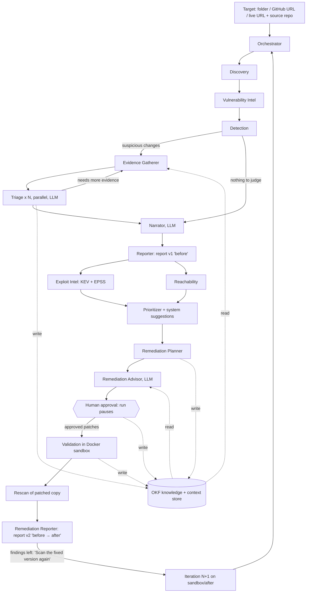

# Supply Chain Guardian: end-to-end workflow

One run is a LangGraph `StateGraph` (`sscg/agents/graph.py`). Routing between steps is plain Python (deterministic,
auditable); LLMs only work inside **Triage**, **Narrator** and **Remediation Advisor**. All steps share one
checkpointed state (`GuardianState`); every handoff is also posted on the message bus (`agents/bus.py` →
`out/<project>/agent_messages.jsonl`, shown on *Agents & loop* and *Logs*).



## What each step does

| # | Step (node) | Kind | Reads | Does | Writes / hands to |
|---|---|---|---|---|---|
| 0 | **Orchestrator** (`workers.plan`) | deterministic | target, options | Decides the run plan: base commit available?, vulnerability lookup on?, remediation on? Records the LLM engine chosen | plan → Discovery |
| 1 | **Discovery** | deterministic | manifests, lockfiles, Dockerfiles, CI files, live page + scripts | Builds the dependency graph (purl ids, per-ecosystem) and the CycloneDX SBOM | graph, SBOM → Vuln Intel |
| 2 | **Vulnerability Intel** | deterministic | every package@version | OSV.dev lookup (CVE / GHSA / MAL-*), CVSS, fixed versions | advisories on graph nodes; OKF `advisory` concepts |
| 3 | **Detection** | deterministic | graph, files, git diff | Runs rules R01–R22: vulnerabilities + suspicious changes (typosquat, install scripts, untrusted sources, lockfile drift, CI, containers, SRI) and clusters them by root cause | findings, risk clusters. Suspicious, triage-worthy findings → Evidence Gatherer; vulnerabilities skip AI |
| 4 | **Evidence Gatherer** (`gather_evidence`) | deterministic | each queued finding | Runs read-only tools: registry metadata, file context, commit history, graph context, **okf_search** (always), okf_read/neighbors when asked | evidence packet → Triage; questions/answers on the bus |
| 5 | **Triage ×N** (parallel `Send`) | **LLM** (rules fallback) | evidence packet, shown OKF concepts | Verdict (malicious / suspicious / likely benign / needs human), confidence, 1-sentence summary, ≤3 reasons each tied to evidence, recommended action. May ask for one more evidence round | triage notes (unverified) → OKF; → Narrator |
| 6 | **Narrator** | **LLM** | findings + triage | Plain-language summary (labelled AI inference) | summary |
| 7 | **Reporter** | deterministic | everything so far | Writes the single report (`report.md/html/pdf`) in its *before* state, findings.json, graph | → Exploit Intel ‖ Reachability |
| 8a | **Exploit Intel** | deterministic | CVEs | CISA KEV (known exploited) + FIRST EPSS (exploit probability) | exploitability |
| 8b | **Reachability** | deterministic | source imports | Is the vulnerable package imported? Is the app a network service? | reachability |
| 9 | **Prioritizer** | deterministic | findings, 8a, 8b, triage | Score → P0–P3, urgent flag. Low-priority items get a **System suggestion** (accept risk / defer / approve) | priorities → Planner |
| 10 | **Remediation Planner** | deterministic | priorities, clusters, registry versions, playbooks | One proposal per root cause: upgrade / replace / remove / pin, exact file edits + diff, compatibility level, rollback | proposals → OKF `remediation-plan` |
| 11 | **Remediation Advisor** | **LLM** | proposals, OKF pack (playbooks + past human decisions on the same package) | Explains each proposal in plain words and adds a reviewer checklist. Cannot change the patch | ai_rationale → Human |
| 12 | **Human approval** | human (LangGraph `interrupt`) | proposal cards: patch on the left, reasoning + system suggestion on the right | Run pauses and is checkpointed (SQLite). Human approves / rejects / accepts risk / requests changes, with name + reason | approvals → OKF `decision` (trusted) |
| 13 | **Validation (Docker sandbox)** | deterministic, containers | approved patchable proposals | See below | validation result, patch, post_analysis.json, sandbox_trace.json |
| 14 | **Remediation Reporter** | deterministic | all state + validation | Rewrites the same single report with *before → after*; writes remediation.json | → Human (next iteration) |

## The sandbox (step 13), in order

Original repository is never modified. All work happens in a temp copy (`%TEMP%/sscg-validate-<run>/`) and
inside throw-away containers on the local Docker engine.

1. **Copy + apply**: copy the repo to `after/`, apply the approved edits (manifest version changes etc.).
2. **Create the sandbox**: a named volume (`/work`), an `--internal` Docker network, and an allow-list proxy
   container that only lets `CONNECT` to package registries (npm, PyPI, Maven Central) on 443. Every object is
   labelled `sscg.sandbox=<id>`; `docker events` for that label is recorded to `docker_events.log`.
3. **Load code as data**: tar-stream the repo into the volume (no host mounts, symlinks dropped). For GitHub
   targets the checkout itself is done by `git` inside a container.
4. **Baseline (before)**: install with registry-only network, then build/test with `--network none`.
5. **Remediated (after)**: regenerate lockfiles if needed (`npm install --package-lock-only`), `npm ci` /
   `pip install -r` / `mvn dependency:go-offline`, then `npm test` / `pytest` / `mvn test` with no network.
6. **Hardening on every container**: pinned image digests, non-root `1000:1000`, read-only root FS, `--cap-drop ALL`,
   `no-new-privileges`, 2 CPU / 2 GB / 512 PIDs, no host env.
7. **Proof**: each container's name, image digest, command, network, start, duration, exit code and log tail →
   `sandbox_trace.json`; shown on *Remediation → Sandbox proof*. Containers and volume are removed at the end.
8. **Rescan**: the patched copy is scanned again with the same discovery + vulnerability + detection rules.
9. **Compare**: resolved / remaining / newly introduced findings, SBOM diff, build/test before vs after →
   verdict (verified / partially verified / failed) and `post_analysis.json`; patch saved as `remediation.patch`.

No Docker → nothing from the repository is executed on the host; only the lockfile + rescan run, and the report says so.

## The loop

```
iteration 0: original target ──scan→triage→prioritize→propose→approve→sandbox→rescan──► findings N0 → N1
iteration 1: <sandbox>/after  ──same pipeline──────────────────────────────────────────► N1 → N2
...           until findings = 0, or they stop going down, or the human stops
```

- *Post-analysis* tab → **Scan the fixed version again** starts the next run on `sscg-validate-<run>/after`.
- The server names it `<project>__iter<N>` and writes `iteration.json` (parent link); *Agents & loop* shows the chain
  and the findings count per iteration.
- Each iteration reuses OKF: triage and the advisor see the previous iteration's verdicts and human decisions.
- Each iteration needs a human click (and new approvals): nothing is applied automatically.

## Knowledge (OKF) touch points

| Step | Reads | Writes |
|---|---|---|
| Vulnerability Intel | – | `advisory` concepts |
| Evidence Gatherer / Triage | playbook for the rule, attack patterns, policy, advisories, past decisions on the package (only ids it was shown) | `triage` notes (unverified) |
| Prioritizer / Planner | playbooks (fix options) | `risk-cluster`, `remediation-plan` |
| Remediation Advisor | OKF pack: playbooks + earlier human decisions | – |
| Human approval | – | `decision` (approved trust) |
| Validation | – | `validation-result` |

## Where to see it in the UI

Overview (pipeline stepper) · Supply chain (ecosystem graph) · Vulnerabilities / Suspicious changes · AI triage
(reasoning cards) · Remediation (approval, Post-analysis, Sandbox proof) · Agents & loop (bus + iterations) ·
Knowledge (OKF) · Logs (full run log, stage timeline) · Reports (single report, PDF).
